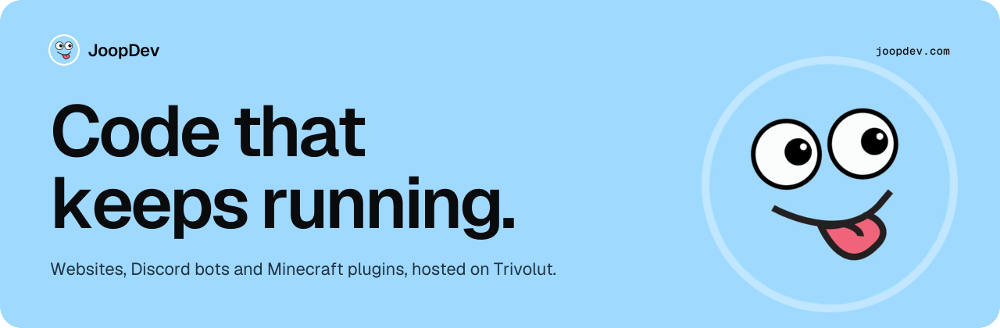

## Hi, I'm Johannes

I'm a developer and founder from the Netherlands, building as **JoopDev**.
I make websites, Discord bots and Minecraft plugins, and I host them on my own platform, **[Trivolut](https://trivolut.com)**.

 

### What I'm working on

| Project | About |
|:--|:--|
| **[Trivolut](https://trivolut.com)** | My hosting company. Web hosting, VPS and game servers on a custom Laravel portal with Pterodactyl. |
| **United Clan RP** | A Minecraft roleplay network I own and run. |
| **Nexus Play** | A Discord minigame bot: Word Chain, Hangman, Guess the Flag, Crack the Code and more. |
| **NextGenNPCs** | The zNPCs plugin, rebuilt for Minecraft 1.21 and up. |

### Open source

| Repository | What it does |
|:--|:--|
| [nextjs-egg-pterodactyl](https://github.com/joopdev/nextjs-egg-pterodactyl) | Run Next.js apps on Pterodactyl. Installs, builds and starts automatically. |
| [pterodactyl-installer](https://github.com/joopdev/pterodactyl-installer) | Install, update and manage Pterodactyl Panel and Wings with one script. |
| [paymenter-autoinstall](https://github.com/joopdev/paymenter-autoinstall) | Paymenter on Ubuntu 24.04, with Nginx, database and SSL. |
| [discord-bot-egg](https://github.com/joopdev/discord-bot-egg) | A self-updating Pterodactyl egg for Node.js Discord bots. |
| [AskLocation](https://github.com/joopdev/AskLocation) | A small Paper plugin to ask players for their coordinates. |

### Stack

`TypeScript` `JavaScript` `PHP` `Java`  
`Node.js` `Next.js` `Laravel` `discord.js` `Paper`  
`Linux` `Docker` `Pterodactyl` `Nginx` `GitHub Actions`

### Contact

[joopdev.com](https://joopdev.com) · [info@joopdev.com](mailto:info@joopdev.com) · [Discord](https://discord.com/users/802116609732247572)
